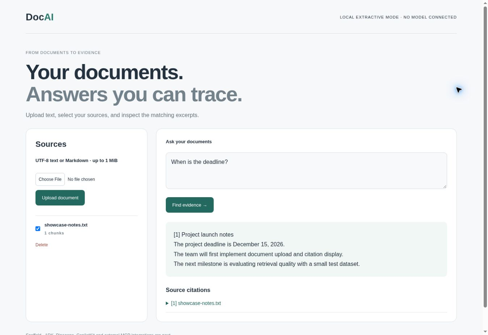
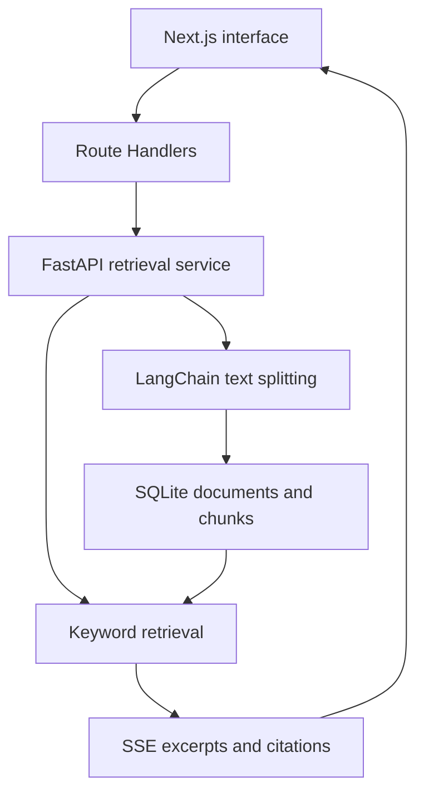

# DocAI

### From documents to traceable answers

Upload a document, ask a question, and inspect the source behind the response. This full-stack document Q&A project includes a working local retrieval workflow and integration boundaries for a future RAG agent.

**Next.js · React · TypeScript · FastAPI · LangChain text splitting · SQLite · SSE**

[Run locally](#run) · [Integration boundaries](docs/INTEGRATIONS.md) · [Development roadmap](docs/NEXT_STEPS.md)



*Actual browser capture: a sample document was uploaded, selected and queried. The response quotes matching source text and includes a citation.*

## Engineering highlights

- Upload, list and delete UTF-8 text or Markdown documents with a 1 MiB upload limit.
- Split text into chunks and persist documents in SQLite under browser-session namespaces.
- Retrieve matching excerpts and stream text plus citation state through an AG-UI-shaped SSE subset.
- Next.js Route Handlers proxy the Python service and reject mismatched browser origins.
- Integration checks cover document lifecycle, citations, namespace isolation and origin rejection.

## Architecture



## Current scope

| Working local demo | Next milestones |
| --- | --- |
| Document ingestion and persistent local storage | Embeddings and Pinecone retrieval |
| Keyword retrieval with excerpts and citations | Model-generated answers and ADK orchestration |
| Streaming UI and session namespaces | CopilotKit runtime, MCP tools and web search |

**Status: runnable retrieval scaffold, in active development.** Local mode is extractive: it quotes source text, makes no model calls and requires no API key. Session namespaces are not account authentication. [Screenshot reproduction](docs/SHOWCASE.md).

## Run
Python 3.12+, Node 22.12+.

```sh
cd agent
python -m venv .venv
source .venv/bin/activate
# Windows PowerShell instead: .venv\Scripts\Activate.ps1
python -m pip install -r requirements.lock.txt
python -m uvicorn document_ai.app:app --host 127.0.0.1 --port 8000
```

In a second terminal:
```sh
cd frontend
npm ci
npm run dev
```

Open http://localhost:3000 and upload `examples/project-notes.txt`. Ask `When is the deadline?`.
Next.js forwards through its own API routes to the local Python service. `AGENT_BASE_URL` is server-only; `.env.local` may override it. When running behind a reverse proxy, set the server-only `APP_ORIGIN` to the exact browser-facing origin (for example, `https://documents.example.com`); other origins remain rejected.

## Next integrations
`agent/document_ai/integrations` contains optional ADK/Pinecone/MCP integration entry points. See [integration boundaries](docs/INTEGRATIONS.md). Google ADK orchestration, dense/vector and hybrid retrieval, CopilotKit runtime, full AG-UI input compatibility, external MCP tools, web search and model generation are **not connected or live-tested**.
Model IDs are configurable; choose a supported model when implementing the generation adapter.

This is a local, single-machine development demo. Namespace separation is not account authentication. Do not expose the Python port or deploy private documents until authentication, authorization, quotas and retention controls are implemented.

## Validation
Verified locally: frontend production build; five Python test cases; end-to-end HTTP checks through Next.js for upload, retrieval, citation streaming, session isolation, deletion and browser-origin rejection. External integrations were not exercised.

```sh
cd agent
python -m unittest discover -s tests -v
cd ../frontend
npm run build
```

See [development roadmap](docs/NEXT_STEPS.md) and [architecture](docs/ARCHITECTURE.md).
